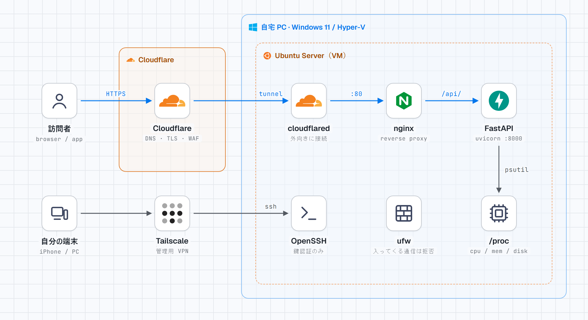

# ServerStudy

自宅サーバー（Hyper-V + Ubuntu Server）でサーバーサイドを勉強する記録。

- [用語集](glossary.md)

## 詳しいメモ

| フォルダ | 内容 |
|---|---|
| [virtualization/](virtualization/) | 仮想化・OS |
| [linux/](linux/) | Linux の操作 |
| [network/](network/) | ネットワーク |
| [ssh/](ssh/) | ssh |
| [web/](web/) | Web |
| [security/](security/) | 公開・セキュリティ |

## 今の構成

<picture>
  <source media="(prefers-color-scheme: dark)" srcset="diagrams/architecture-dark.png">
  
</picture>

（[stack-diagram](https://github.com/caru-ini/stack-diagram) で作成。元の HTML は [diagrams/architecture.html](diagrams/architecture.html)）

```
iPhone ─ Wi-Fi ─ Windows（192.168.11.10:8080）
                    │ ポートフォワーディング
                    │ NATSwitch（192.168.100.0/24）
                    └ Ubuntu Server 26.04.1 LTS（192.168.100.10）── nginx（80）

iPhone（どこからでも）═ Tailscale ═ Ubuntu（100.114.194.19）

世界中のブラウザ ─HTTPS─ Cloudflare ═ トンネル ═ cloudflared（Ubuntu）─ nginx（localhost:80）
  https://test.hiromu-lab.dev                                              ├ test   → Hello のページ
  https://status.hiromu-lab.dev/api/status                                 └ status → uvicorn（127.0.0.1:8000）健康診断 API
```

## 通信経路

「どこから・どこへ・何番」の一覧（通信要件表）。**この表に載っていない通り道は、存在してはいけない。**

| どこから | どこへ | ポート | 用途 | 通り道 |
|---|---|---|---|---|
| 自宅 Wi-Fi の機器 | Windows `192.168.11.10` | 8080 | HTTP | Windows が Ubuntu の 80 番に転送 |
| Windows | Ubuntu `192.168.100.10` | 22 | ssh | NATSwitch |
| Windows | Ubuntu `192.168.100.10` | 80 | HTTP | NATSwitch |
| Tailscale の機器（iPhone など） | Ubuntu `100.114.194.19` | 22, 80 | ssh, HTTP | Tailscale |
| インターネット | `test.hiromu-lab.dev` | 443 | HTTPS | Cloudflare → トンネル → nginx の 80 番（→ [手順](security/cloudflare-tunnel-setup.md)） |
| インターネット | `status.hiromu-lab.dev` | 443 | HTTPS（API、合言葉が必要） | Cloudflare → トンネル → nginx の 80 番 → uvicorn `127.0.0.1:8000`（→ [健康診断 API](web/status-api.md)） |
| インターネット | 自宅のグローバル IP | どれも | - | 入口なし（ルーターも ufw も閉じたまま） |

- 「HTTP」は、ブラウザでも `curl` でも iOS の `URLSession` でも同じ。扉から見ると区別はない
- ✅ ufw でデフォルト拒否にして、この表の通り道だけを許可している（→ [ファイアウォール（ufw）](security/firewall.md)）
- ✅ ssh は鍵でしか入れない（→ [ssh の強化](ssh/hardening.md)）
- 確認方法：設定は `sudo ufw status verbose`、中で開いているポートは `sudo ss -tlnp`、外からは `curl.exe --max-time 5` や Mac の `nc -vz IP ポート`

## ロードマップ

- [x] Hyper-V に Ubuntu Server を入れる
- [x] Windows から ssh で接続する
- [x] nginx で Web ページを表示する
- [x] ポートフォワーディングで iPhone から見る
- [x] 内部仮想スイッチを作って IP を固定する
- [x] Tailscale で、自分だけどこからでも入れるようにする
- [x] ssh の強化とファイアウォール
- [x] 自作の Web アプリ（API）を作って、nginx の裏で動かす（健康診断 API）
- [x] ドメイン + Cloudflare Tunnel で HTTPS 公開する（`https://test.hiromu-lab.dev`）
- [ ] 運用保守（自動アップデート、ログ、バックアップ、デプロイ手順）
