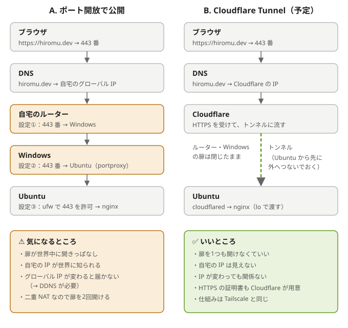

# 世界に公開する方法（ポート開放 と Cloudflare Tunnel）

## ひとことで言うと
自宅サーバーを世界に見せるには、外から来た通信を Ubuntu まで通す必要がある。やり方は2つ。

- **A. ポート開放**：ルーターなどの扉を開けて、外から入れるようにする
- **B. Cloudflare Tunnel**：扉は閉じたまま、Ubuntu のほうから Cloudflare にトンネルをつないでおく



## 仕組み
### 前提：今のルーターは外からの番号を1つも知らない
外から来た通信は、`:22` でも `:8000` でも `:8080` でも全部黙って捨てている（→ タイムアウト）。だから今の自宅サーバーはインターネットから見えない。

### 言葉の整理
| 言葉 | 意味 |
|---|---|
| NAT | 住所を書き換えて、メモ帳で返事を戻す **仕組み** そのもの（ルーターに最初から入っている） → [NAT](../network/nat.md) |
| ポートフォワーディング（ポート開放） | そのメモ帳に「443 番に来たらこの機械へ」と **手で書いておく設定**。Windows の `portproxy` もこの一種 |
| DNS | ドメイン → **IP だけ** を教える。ポートは教えない → [DNS](../network/dns.md) |
| ポート番号 | URL の頭で決まる。`https://` → 443 番、`http://` → 80 番（書かなければ自動） |

### A. ポート開放
```
ドメイン →（DNS）→ 自宅のグローバル IP、https なので 443 番
→ ルーターがポートフォワーディングで Windows へ
→ Windows が portproxy で Ubuntu へ
→ ufw が 443 を許可 → nginx
```
二重 NAT なので、扉を2回（ルーターと Windows）開ける必要がある。昔からある、立派な公開方法。ただし扉が世界中に開きっぱなしになり、自宅の IP も知られる。

### B. Cloudflare Tunnel
- DNS は **Cloudflare の IP** を返す。訪問者は Cloudflare に話しかけていて、自宅の IP は見えない
- Ubuntu の `cloudflared` が、**先に中から外へ** Cloudflare に接続しておく。NAT のメモ帳に記録が残るので、その道を通ってリクエストが入ってこられる（Tailscale と同じ考え方）
- 届いたリクエストは、`cloudflared` が `lo`（localhost）で nginx に渡す

### Cloudflare がやってくれること・やってくれないこと
| 自分の最初の理解 | 正確には |
|---|---|
| グローバル IP を隠すために、代わりの IP を用意してくれる | ほぼ正解。Cloudflare 自身が **受付（リバースプロキシ）** になり、DNS は Cloudflare の IP を返す。ただし隠れるのは「訪問者から」だけで、自宅から外に出る通信は今まで通り自宅の IP |
| ルーターの役割をすべて Cloudflare がやってくれる | 「外からの入口」の役割だけを肩代わりしてくれる。ルーターは今まで通り NAT をしていて、トンネルの通信もルーターを通る。ただ、**扉を開ける必要がない** |
| Windows さえ通さずに Ubuntu に設定する | **設定は Ubuntu だけ** で正解。ただし通信は Windows（NAT）とルーターを通っている。「通らない」のではなく「設定がいらない」 |

### 「すべて任せる」でいいの？
Cloudflare が守ってくれるのは **入口まで**。入口を通ってきた正しい形のリクエストは、そのまま自作アプリに届く。

- アプリの穴（SQL インジェクションなど）は自分の責任
- Cloudflare は HTTPS をいったんほどくので、通信の中身を見られる立場にある（信頼して預けている）
- 管理用の ssh は Cloudflare に出さず、Tailscale だけにしておく（公開用の道と管理用の道を分ける）

## 自分の環境では
- 今は A も B もしていない。ルーターのポートは1つも開けていない
- **B（Cloudflare Tunnel）** を使う予定。ルーターも Windows も設定を変えずに、Ubuntu に `cloudflared` を入れるだけで公開できる

## 関連する用語
- [用語集](../glossary.md#公開セキュリティ)
- [NAT](../network/nat.md)、[DNS](../network/dns.md)、[VPN と Tailscale](vpn.md)、[ファイアウォール（ufw）](firewall.md)、リバースプロキシ、DDNS
