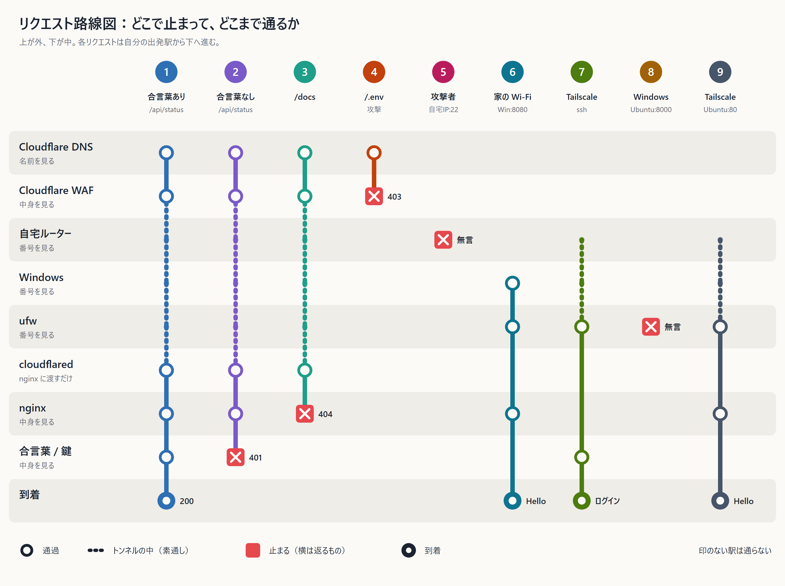

# リクエスト路線図（どこで止まって、どこまで通るか）

## ひとことで言うと

自宅サーバーへ来るリクエストを「電車の路線」に見立てて、**どの駅（守り）で止まるか・どこまで通るか**を並べた図。
守りは大きく2種類に分かれる。**番号（IP とポート）を見る守り**と、**中身（URL やヘッダー）を見る守り**。

<picture>
  <source media="(prefers-color-scheme: dark)" srcset="../diagrams/request-routes-dark.png">
  
</picture>

（元の HTML は [diagrams/request-routes.html](../diagrams/request-routes.html)）

## 駅（守り）の一覧

上から順に、外 → 中。

| 駅 | 見るもの | 何をする |
|---|---|---|
| Cloudflare DNS | 名前 | `status.hiromu-lab.dev` → Cloudflare の住所を教える（自宅の IP は教えない） |
| Cloudflare WAF | **中身** | 攻撃っぽい URL（`/.env` など）を **403** で止める |
| 自宅ルーター | 番号 | ポートフォワーディングが1つもないので、外から来た通信は**黙って捨てる** |
| Windows | 番号 | `8080` に来たものだけ、Ubuntu の `80` に転送する（portproxy） |
| ufw | 番号 | 下の4つだけ通す。それ以外は黙って捨てる |
| cloudflared | - | トンネルから出てきたリクエストを `http://localhost:80` に渡す |
| nginx | **中身** | Host と URL で振り分け。`status.` の `/api/` だけ uvicorn へ、それ以外は **404** |
| 合言葉 / 鍵 | **中身** | API は `X-API-Key` が違えば **401**。ssh は鍵がなければ入れない |

ufw で通しているもの（[ファイアウォール（ufw）](firewall.md)）：

```
eth0 から、送り主が 192.168.100.0/24（＝Windows 側）→ 22, 80
tailscale0 から（送り主は問わない）               → 22, 80
```

- `eth0` は NATSwitch につながった出入口（`192.168.100.10`）、`tailscale0` は Tailscale が作った出入口（`100.114.194.19`）
- tailscale0 に送り主の条件がないのは、そこに来られるのが**自分の Tailscale アカウントの端末だけ**だから
- 8080 は開けていない。8080 は **Windows の扉**で、Ubuntu に届くときには「Windows（`192.168.100.1`）から 80 番」に変わっている。ufw には iPhone の IP は見えない

## 路線

記号：○ 通過 ／ ✕ 止まる ／ ◎ 到着 ／ ┊ トンネルの中（中身は暗号化されていて、途中の駅はチェックしない）

### 1. 合言葉つきで `https://status.hiromu-lab.dev/api/status`

```
DNS ○ → WAF ○ ┊ トンネル（ルーター・Windows・ufw は素通し）┊ cloudflared ○ → nginx ○（/api/）→ 合言葉 ○ → ◎ 200 と JSON
```

### 2. 合言葉なし

```
1 と同じ道 → 合言葉 ✕ → 401 {"detail":"unauthorized"}
```

### 3. `/docs`

```
DNS ○ → WAF ○ ┊ トンネル ┊ cloudflared ○ → nginx ✕ → 404（/api/ 以外は全部 404）
```

FastAPI 側でも `docs_url=None` で消してあるので二重に止まる。

### 4. `/.env` を探す攻撃

```
DNS ○ → WAF ✕ → 403
（もし WAF をすり抜けても nginx で 404）
```

- **最初は止まらなかった**：無料プランの WAF のままだと Cloudflare は素通しで、nginx が 404 を返していた
- そこで Cloudflare の「セキュリティルール」→「カスタムルール」に `block-dotenv`（**URI パス** が `/.env` を **含む** → **ブロック**）を足した。今は Cloudflare の「Sorry, you have been blocked」画面で 403 になる
- 見分け方：ヘッダーの `Server:` は Cloudflare を通ると nginx の返事でも `cloudflare` になる。**本文の一番下**に `nginx/...` があれば nginx、`Cloudflare Ray ID` があれば Cloudflare が返している

### 5. 攻撃者 → 自宅のグローバル IP の 22 番

```
ルーター ✕ → 黙って捨てる
```

- 「22 番をどの機器に届けるか」の設定がないので、ルーターは何もしない
- 返事をしないのは、「ここに何かある」と攻撃者に教えないため。相手はタイムアウトするだけ

### 6. 家の Wi-Fi の iPhone → Windows `192.168.11.10:8080`

```
Windows ○（8080 → Ubuntu:80 に転送）→ ufw ○（192.168.100.x から 80）→ nginx ○（default）→ ◎ Hello のページ
```

**ルーターの関所は通らない**。家の中どうしの通信なので、外との境目（玄関）を通らない。

### 7. Tailscale の iPhone → ssh

```
┊ Tailscale のトンネル（ルーター・Windows は素通し）┊ ufw ○（tailscale0 の 22）→ 鍵 ○ → ◎ ログイン
```

- ルーターと Windows を物理的には通るが、**Ubuntu の Tailscale が自分から外へかけた電話**（cloudflared と同じ）の返事なので素通し
- ssh はパスワード禁止・鍵だけ。**秘密鍵**（`id_ed25519`）は自分の端末に、**公開鍵**は Ubuntu の `~/.ssh/authorized_keys`（鍵穴のリスト）にある
- Tailscale のログイン + ssh の鍵、で二重

### 8. Windows → Ubuntu `192.168.100.10:8000` に curl

```
ufw ✕（8000 は許可していない）→ タイムアウト
```

Windows が出発地点なので、Windows の駅は通らない。

### 9. Tailscale の iPhone → `100.114.194.19` の 80 番

```
┊ Tailscale ┊ ufw ○（tailscale0 の 80）→ nginx ○（Host が IP なので default）→ ◎ Hello のページ
```

### 10. もし ufw を止めたら（`sudo ufw disable`）、8 はどうなる？

**それでも止まる**。uvicorn が `--host 127.0.0.1` で、`lo` の 8000 番でしか待っていないから。
`eth0` の 8000 番には誰もいないので、カーネルが即座に「いない」と返す。

| 何が止めたか | 相手からの見え方 |
|---|---|
| ufw / ルーター（黙って捨てる） | **タイムアウト**（長く待たされる） |
| 誰も待っていない | **すぐ `Connection refused`** |

確かめ方：`sudo ss -tlnp | grep 8000` → `127.0.0.1:8000` と出れば lo だけで待っている。

## 線を引くときのコツ

- **まず「どこから出発するか」を書く**。出発地点より外側の駅は通らない（6 と 8 で間違えやすい）
- トンネル（Cloudflare Tunnel、Tailscale）は**中から外へかけた電話**。番号を見る駅（ルーター、Windows）は素通しになる
- 番号を見る駅は URL の中身を知らない。`/.env` を止められるのは中身を見る駅（WAF、nginx）だけ

## 関連する用語

- [用語集](../glossary.md#公開セキュリティ)
- [ファイアウォール（ufw）](firewall.md)
- [世界に公開する方法](publish-methods.md)
- [健康診断 API](../web/status-api.md)
